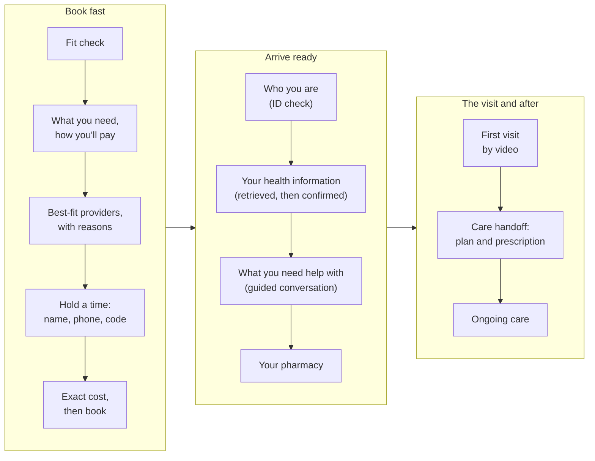

# Book fast, arrive ready

A working prototype of AI-native patient onboarding for Legion Health, built for the Founding Product take-home.
Onboarding here starts on the first page and ends only when the patient's first visit is complete.

- **Book fast.** Quick taps take a patient from the fit check to a booked visit: what brings them here, the kind of help
  they want, how they'll pay (with the typical cost shown right away), the three best-fit providers with the reasons why,
  a time held with a name, a mobile number, and a texted code, the exact coverage check, then the card.
- **Arrive ready.** After booking, Legion looks before it asks. With the patient's permission it retrieves records and
  medication history for the patient to confirm, a short guided conversation replaces the long intake forms, GAD-7 and
  PHQ-9 stay word for word, and the provider sees a ready summary before the visit. After the visit, a care handoff and
  an ongoing-care home take over.
- **Measured per person, through the first visit.** Every step records events under one journey ID, with outcomes from
  the systems of record, and an internal journey view shows them.

**Everything is invented.** The three demo patients, the providers, the insurance checks, the records, the texts, and the
visit are simulated. Two things are live: the AI, when a key is configured, and the National Library of Medicine's free
RxNorm drug vocabulary.

## Try it

- **Hosted:** the URL will be added here after deployment.
- **Locally** (Node 22 or later):

  ```bash
  npm install
  cp .env.example .env.local   # AI keys are optional; without them the AI runs in scripted mode
  npm run dev                  # then open http://localhost:3000
  ```

**Demo controls** (top right, on every page) start a journey as a demo patient, fill the current step, switch on the edge
cases (a slow insurer, a time taken a moment before), mark a safety flag reviewed, and open the journey view at `/journey`.

| Demo patient | What their path shows |
|---|---|
| **Maya Torres**, 29, Austin | The full happy path: a note that becomes preferences, verified coverage with her exact copay, a health summary from two clinics and her pharmacy, the guided conversation, the visit, a new prescription, and a follow-up |
| **Jordan Ellis**, 34, Houston | Self-pay with no insurance wording anywhere, no openings in his chosen times, an empty records search, and a cash-paid stimulant caught by "anything else you take?", which brings in the prescription-monitoring check |
| **Sam Rivera**, 22, El Paso | Mountain Time, a plan lookup that finds nothing, a plan that turns out inactive, and a PHQ-9 item 9 answer that shows crisis help at once and flags a person for same-day review while the visit stays booked |

Starting with no demo patient works too: every stage completes with generic invented results.

## The journey at a glance



## What changed from today, and why

| Today (from the walkthrough and PostHog data) | In this prototype |
|---|---|
| The funnel counts browser sessions and stops at reaching the payment page | One journey ID per patient, linked to a person at account creation, with outcomes from systems of record through the first visit |
| 36.6% of match-page sessions never pick a provider; no reasons are shown | Three best fits ranked by openings in the times the patient picks; each card leads with why that provider fits, every reason true and sourced; a note in the patient's own words becomes preferences, above the results |
| One in five held slots never becomes an account | A name, a mobile number, and a texted code hold the time; resume from any device by phone |
| Coverage and cost arrive after the card | The typical cost at the plan tap, and the exact coverage check before the card, with "book now, confirm later" if the insurer is slow |
| About 75 to 80 inputs before the visit, mostly typed | Retrieved records and medications to confirm, four short questions in the patient's own words, and short essential-history forms: 15 typed inputs for Maya |
| After booking, a list of separate tasks | A home that follows the patient: visit prep in four areas, then the visit, then a care handoff and ongoing care |

The full diagnosis is in [discovery/diagnosis.md](discovery/diagnosis.md), and the goals, principles, hypotheses, and
journey in [docs/PRODUCT_BRIEF.md](docs/PRODUCT_BRIEF.md).

## Key decisions

| Decision | The tradeoff |
|---|---|
| Measure people through the first visit, not sessions to the payment page | Backend instrumentation and identity linkage cost more than page events |
| Light taps before booking; the depth after it | Prep has to be easy, and the visit stays booked regardless |
| Trust at matching from true, sourced reasons and preferences in the patient's words | Fewer impressive claims |
| Retrieve with consent and let the patient confirm, instead of asking them to type | Depends on vendor match rates, so empty results need a good path |
| Fixed rules for every safety and eligibility call; AI bounded and confirmed by the patient | Less open-ended AI, in exchange for reliability and safety |
| Vendors simulated; the AI and RxNorm live | The demo can't prove vendor match rates |

All twelve, with what each was weighed against: [docs/DECISIONS.md](docs/DECISIONS.md).

## How it's built

The demo is one Next.js app on Vercel. A pure, tested state machine on the server decides every transition, fixed rules
decide eligibility and safety, simulated vendors answer asynchronously the way the real ones do, an AI router runs three
bounded tasks, and Upstash Redis holds journeys and their events. In production the same core sits behind real vendor
adapters (Sohar, Metriport, DoseSpot, Persona, Stripe, and Legion's scheduling and visit systems) and Legion's database.

| Part | In this demo | In production |
|---|---|---|
| AI: preference chips, conversation notes, clinician summary | **Live** through a router (OpenAI, then Anthropic, then Google), with a scripted fallback | The same router, under BAAs, with evaluation gates |
| Medication names mentioned in the conversation | **Live:** matched to RxNorm at the ingredient or brand level | RxNorm, or DoseSpot's drug database |
| Eligibility, crisis routing, PHQ-9 item 9, controlled substances | Fixed rules, tested | The same rules |
| Insurance, records, medication history, ID check | Simulated, asynchronous | Sohar, Metriport, DoseSpot (Surescripts), Persona |
| Scheduling, payment, texts, video visit | Simulated | Legion's systems and Stripe |
| Storage and analytics | Upstash Redis; an event log and `/journey` | Legion's database; PostHog and the warehouse |

Production and the demo, each with diagrams of the flows: [docs/ARCHITECTURE.md](docs/ARCHITECTURE.md). Every service,
why it was chosen, its limits, and what was left out: [docs/SERVICES.md](docs/SERVICES.md).

## Safety, AI, and privacy

- **Rules decide; AI assists.** Eligibility, crisis routing, safety flags, and controlled-substance handling are fixed
  rules. A crisis-language check runs before every model call, and on a match no model is called.
- **The AI's job is bounded.** It turns a note into preference chips, turns answers into short notes the patient edits,
  picks at most one follow-up from a fixed bank, and drafts a clinician summary that a filter checks for advice,
  assessments, and anything the patient didn't say. The patient confirms everything before it's saved.
- **Nothing typed is stored**, apart from the notes and summary the patient confirms. Events carry codes and timings,
  never answers.
- **Consent comes before every retrieval**, and every prefilled fact shows where it came from.
- How the AI is evaluated today, and what production needs to control quality and performance: [docs/AI.md](docs/AI.md).

## Tests

```bash
npm run verify     # typecheck, lint, unit and integration tests, then end-to-end tests against a production build
npm run eval:ai    # live AI evaluation on every provider with a key, and a live RxNorm check; writes to docs/QA.md
npm run e2e:live   # optional: the real AI and RxNorm through the real screens
```

`npm run verify` runs 200 unit and integration tests (golden event sequences for each demo patient, linkage, metrics, data
quality, visit-prep rules, the AI router, and RxNorm lookup with stand-ins for the live services) and 46 end-to-end runs (23
tests at phone and desktop sizes, with axe accessibility checks on every stage screen). These suites keep RxNorm
unreachable on purpose, which proves the journey survives an outage. The visual review of every screen is logged in
[docs/QA.md](docs/QA.md).

## Configuration

| Variable | Purpose |
|---|---|
| `AI_PROVIDER` | `openai` (default), `anthropic`, `google`, or `scripted` |
| `OPENAI_API_KEY`, `ANTHROPIC_API_KEY`, `GOOGLE_GENERATIVE_AI_API_KEY` | Optional provider keys; the router skips providers without one |
| `AI_MODEL_QUALITY`, `AI_MODEL_FAST` | Optional model overrides for the active provider |
| `AI_DAILY_LIVE_CALLS` | Live AI calls allowed per day across all journeys (default 1,500) |
| `UPSTASH_REDIS_REST_URL`, `UPSTASH_REDIS_REST_TOKEN` (or the `KV_REST_API_*` pair) | Redis for the hosted demo (required on Vercel); leave empty locally to use memory |
| `SESSION_SECRET` | Signs the journey cookie; required on Vercel |
| `DEMO_MODE`, `DEMO_FAST` | Demo controls and shown codes; `DEMO_FAST=1` shortens simulated waits for tests |
| `RXNORM_URL` | Optional; empty means NLM's public RxNorm API. The test suites point it at an unreachable address on purpose |

Models are set in one place, [src/config/ai.config.ts](src/config/ai.config.ts). Deploying: [docs/DEPLOY.md](docs/DEPLOY.md).

## Documents

**Start here**
- [docs/DECISIONS.md](docs/DECISIONS.md): the key decisions and their tradeoffs, most important first
- [docs/PRODUCT_BRIEF.md](docs/PRODUCT_BRIEF.md): goals, metrics, principles, hypotheses, the concept, and the journey

**Deep dives**
- [docs/ARCHITECTURE.md](docs/ARCHITECTURE.md): production, the demo, and the path between them, with flow diagrams
- [docs/SERVICES.md](docs/SERVICES.md): every service, why it was chosen, its limits, and the alternatives not used
- [docs/AI.md](docs/AI.md): where AI is used, how it's bounded, and the evaluation plan
- [docs/TRD.md](docs/TRD.md): the technical requirements, the telemetry plan, and 66 acceptance criteria
- [docs/QA.md](docs/QA.md): the live AI evaluation, the RxNorm check, and the visual review
- [docs/INTEGRATIONS.md](docs/INTEGRATIONS.md): the vendor research behind the service choices, with sources
- [docs/DEPLOY.md](docs/DEPLOY.md): deploying the demo

**Background**
- [discovery/](discovery/): the current-state observation of Legion's flow, design language, and funnel
- [STATUS.md](STATUS.md): decisions, gates, and progress
- [ai_history/](ai_history/): the AI interaction history
