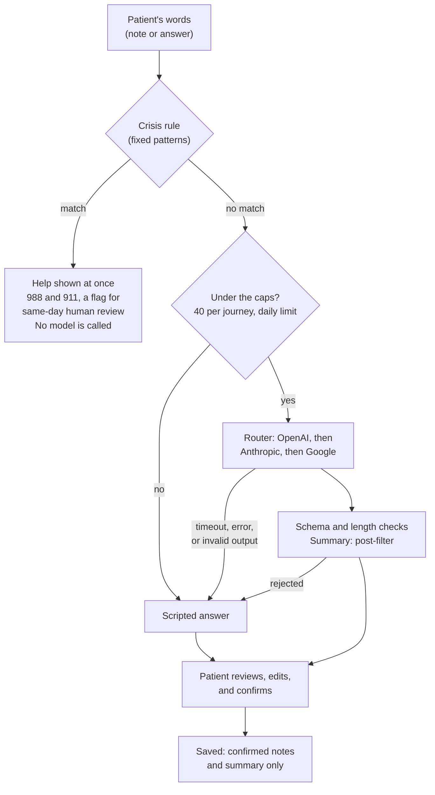

# AI in onboarding: what it does, how it is bounded, and how we would know it works

> **At a glance**
> - **Three small jobs, all confirmed by the patient:** turning an optional note into preference chips, turning conversation answers into short notes, and drafting the clinician summary.
> - **AI never makes a safety or eligibility call.** Fixed rules decide crisis routing, PHQ-9 item 9, eligibility, and controlled-substance handling. A crisis check runs before every model call, and on a match no model is called at all.
> - **Every output is checked before anyone sees it:** a fixed schema, length limits, a fixed follow-up bank, and, for the clinician summary, a filter that rejects advice, assessments, and anything the patient didn't say.
> - **A router keeps it reliable:** OpenAI first, then Anthropic and Google, then a scripted fallback. Each output is tagged "AI · live (provider)" or "AI · scripted."
> - **Evaluated today** on every provider with invented patients (results in [QA.md](QA.md)). **Before production** it needs clinician-labeled test sets, release gates, and live monitoring, described in section 4.

## 1. Where AI is used, and where it isn't

| Job | Where | What goes in | What comes out | Model tier and time limit | What the patient does with it |
|---|---|---|---|---|---|
| **Preference chips** | Choosing a provider: "Anything else that matters to you?" | The patient's note, up to 300 characters | Up to five chips from a fixed set of kinds (gender, language, focus, time, other). The labels are written by code, not by the model. | Fast, 8 seconds | Sees them as "Your preferences," can edit or remove any, and the list re-ranks. Chips never hide a provider. |
| **Conversation notes** | Visit prep: four questions in the patient's own words | One answer | Up to eight short notes of fixed kinds (concern, onset, duration, trigger, prior treatment, medication mentioned, goal, preference), and at most one follow-up chosen by ID from a fixed bank | Quality, 15 seconds | Reviews and edits every note before anything is saved |
| **Clinician summary** | The end of the conversation | Only the notes the patient confirmed, plus what they tapped at booking | One paragraph of at most 900 characters for the provider | Quality, 20 seconds | Reads it and confirms it before it is saved |

**Not AI, by design:**
- Eligibility, crisis routing, PHQ-9 item 9, and controlled-substance handling are fixed, tested rules (L3).
- Provider filtering and ranking are rules. AI only turns a note into chips, and the chips re-order the list.
- GAD-7 and PHQ-9 are shown word for word, never paraphrased.
- Medication names are matched to RxNorm by a vocabulary lookup, not a model.

The models are set in one place, [`src/config/ai.config.ts`](../src/config/ai.config.ts):

| Provider | Quality tier | Fast tier |
|---|---|---|
| OpenAI (first) | `gpt-6.1-sol` | `gpt-6-luna` |
| Anthropic | `claude-opus-5-5` | `claude-haiku-5-5` |
| Google | `gemini-3.8-flash` | `gemini-3.5-flash-lite` |

## 2. How one request flows

## 3. The controls that are built in

- **Rules first.** The crisis check runs on every free-text input inside the router, so no caller can reach a model without it. It is deliberately broad: a false alarm shows resources and asks a person to review, and never blocks care. The patient's edited notes are checked again when saved.
- **Fixed shapes.** Every task has an output schema. The follow-up question is chosen by ID from a fixed bank of written questions, so the model never writes a question to a patient. Chip labels are written by code.
- **The summary post-filter.** It rejects advice ("should," "recommend"), assessments ("likely," "consistent with"), second-person wording, and any diagnosis, medication, or dose the patient didn't mention. A rejected summary falls back to the scripted one, which restates only the confirmed notes.
- **The patient confirms.** Nothing an AI produced is saved until the patient has seen and confirmed it.
- **Nothing typed is stored.** Free text is processed in memory. Only confirmed notes and the summary are saved, and events carry codes and timings, never words.
- **The note is data, not instructions.** Each prompt says so, and the output schema leaves no room for anything but chips or notes.
- **Cost and latency limits.** 40 live calls per journey, a daily cap across all journeys (`AI_DAILY_LIVE_CALLS`, default 1,500), a time limit per task, and a 25-second budget per request across all providers.
- **Clear labels.** Every AI result says whether a live model or the scripted fallback produced it, and which provider.

## 4. Evaluation plan: controlling quality and performance

The principle: evaluate each job against what it must never get wrong, gate every change on those evaluations, and keep watching once it's live. The thresholds below are proposed starting points, to set with Legion's clinical team.

### 4.1 What "good" means for each job

| Job | Must never | Quality measures | Proposed bar before launch |
|---|---|---|---|
| **Preference chips** | Invent a preference the patient didn't state; obey instructions inside the note | Precision and recall of chips against labeled notes; prompt-injection resistance; coverage of other languages and code-switching (English and Spanish first) | No invented chips on the labeled set; recall of 90% or more; every injection attempt ignored |
| **Conversation notes** | Add a fact, a diagnosis, or advice; change a medication name or dose | Faithfulness (every note traceable to the answer); coverage of the facts a clinician needs (onset, duration, medications, prior care, goals); dose fidelity; follow-up relevance | 98% or more of notes judged faithful, with every unfaithful note reviewed; medication names and doses kept exactly; coverage of 90% or more |
| **Clinician summary** | Say anything the patient didn't confirm; advise or assess | Faithfulness to the confirmed notes; completeness; clinicians' usefulness rating; post-filter block rate; how often patients edit or reject it | No ungrounded statements on the labeled set; coverage of 90% or more; clinicians rate 4 of 5 or higher |
| **Crisis rule** (not AI, but the gate in front of it) | Miss explicit language about suicide, self-harm, or harming others | Recall on a clinician-labeled set of direct and indirect phrasings; false-alarm rate | Every explicit statement caught; indirect phrasings tracked and added to the rules as found |

### 4.2 Test sets

- **Built with clinicians.** Invented and consented, de-identified examples, labeled with the expected chips, notes, and summary facts. Kept in the repository as fixtures, next to today's demo-patient inputs.
- **Wide on purpose.** Short and long answers, misspellings, slang, different reading levels, Spanish and code-switched answers, sarcasm, and medications given by brand, generic, or nickname with and without doses.
- **Adversarial.** Notes that try to change the rules ("ignore your instructions"), personal details that shouldn't travel, indirect crisis language, and answers that invite advice ("should I double my dose?").

### 4.3 How each measure is taken

- **Automatic checks** on every run: schema validity, length limits, the summary filter, follow-up IDs, and dose fidelity.
- **A model as judge** for faithfulness and coverage, using a different model family from the one being judged. Its agreement with clinician labels is measured before it is trusted, and it never judges safety alone.
- **Clinician review**: a weekly sample of live summaries, plus every one a patient rejected or a filter blocked.
- **Side-by-side comparison** when switching a model or provider: the same inputs through both, judged blind.

### 4.4 Performance and cost

- Latency at the median and the 95th percentile, for each job and provider. Proposed bars at the 95th percentile: 3 seconds for chips, 6 for a conversation note, and 8 for the summary.
- Timeout, fallback, and schema-failure rates per provider.
- Live calls and cost per journey, and how often the caps are reached.

### 4.5 Release gates

- **Any change to a model, a prompt, a schema, or the provider order** runs the full evaluation and must meet every bar before it ships. A regression blocks the change.
- Model IDs and prompts are versioned. Today the saved clinician summary keeps the mode and provider that produced it, and events record whether a result was live or scripted; production adds the model and prompt version.
- A new model runs in shadow on a sample of traffic before it takes over. Rolling back is a configuration change.

### 4.6 Watching it live

- **Dashboards and alerts** for fallback rate, schema failures, post-filter blocks, crisis-rule triggers, latency, and cost, with alerts on sudden changes.
- **Signals from patients and clinicians:** how often patients edit or remove notes and chips, how often they reject the summary, and a "this summary is wrong" button for clinicians.
- **Drift checks** each month: the test sets run against the live configuration, and the results are compared with the last release.
- **A red-team pass** before launch and each quarter, and a fairness review of chips and summaries across languages and patient groups.

## 5. What exists today, and what production adds

| Capability | In this prototype | Needed for production |
|---|---|---|
| Live evaluation | `npm run eval:ai` runs every task on every provider with a key, using the demo patients' inputs and three crisis inputs, and writes results to [QA.md](QA.md). Last run: OpenAI 18 of 18 live and valid, Anthropic 18 of 18, Google 17 of 18 (one timeout fell back to scripted); no crisis input reached a model; every live summary passed the filter. | Clinician-labeled test sets, a calibrated model judge, and the bars in section 4.1 |
| Deterministic tests | Unit tests for the router's failover, the caps, the crisis rule, the summary filter, and the scripted fallbacks, with stand-in models | The same, plus the adversarial set |
| Through the real screens | `npm run e2e:live` drives a live provider through the actual screens and checks the live tags | Shadow traffic and canary releases |
| Monitoring | Every AI response carries its mode, provider, model, latency, and any fallback reason; the saved summary keeps its mode and provider, and events record live or scripted | Those fields stored for every call, dashboards, alerts, sampled clinician review, and drift checks |
| Data handling | Invented data only; nothing typed is stored; events carry codes only | A BAA and zero data retention with each provider used; access controls and audit logs on saved summaries |
