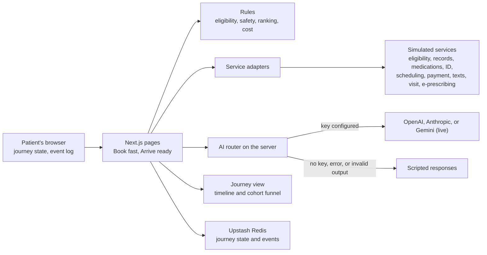

# Architecture

**Status.** Gate 7 was approved on 2026-10-10 with two changes from Emeka:
- **Live AI** runs through a provider router. OpenAI is first, and Anthropic and Gemini can be switched in through a config file. Scripted responses take over when no provider is available.
- **A simple database** (Upstash Redis) is added, so the hosted demo works across devices for anyone who opens it.

The implementation detail is in [TRD.md](TRD.md). This document builds on the approved product brief, [PRODUCT_BRIEF.md](PRODUCT_BRIEF.md).

## 1. Summary

The prototype is one Next.js app on Vercel, built to make "Book fast, arrive ready" real enough to judge how it looks, feels, and behaves. Its main parts:

- **Journey state machine.** The eleven approved stages form a typed state machine.
- **Service adapters.** Every healthcare service sits behind an adapter. In the prototype, each adapter has a simulated implementation that answers differently for each demo patient.
- **Rules.** Eligibility, safety, ranking, and cost are fixed rules, written as tested functions.
- **AI layer.** Language work goes through a provider router: OpenAI by default, with Anthropic or Gemini through a config file. It falls back to scripted responses when no provider is available.
- **Events.** Every stage emits events under one journey identifier, and an internal journey view shows them.
- **Storage.** A small Upstash Redis store holds journey state and events, with an in-memory fallback for local work and tests.

## 2. Live versus simulated (the main decision)

This table applies the service research in [INTEGRATIONS.md](INTEGRATIONS.md), including the seven journey changes approved with Gate 6.

| Capability | Real-world source | In the prototype | Why |
|---|---|---|---|
| Language tasks: the guided conversation, extracting items to confirm, the optional note, and the clinician summary | OpenAI first, with Anthropic and Gemini switchable through `src/config/ai.config.ts` | **Live** when a key is configured. Otherwise a scripted response for each demo patient. | This is the AI-native core, and a real model shows real behavior. The fallback keeps the demo reliable. |
| Eligibility, benefits, insurance lookup, and network status | Sohar Health (Legion uses it today) | Simulated, answering after a short wait, as the real service does. Covers an active PPO, an inactive plan, a lookup that finds nothing, a plan that is slow to answer, and network status for each provider. | Its sandbox returns canned test data, which is what the simulation shows. A live connection needs Legion's credentials. |
| Medical records | Metriport (Legion uses it today) | Simulated, arriving in the background. Covers two sources found, nothing found, and one source found. | Real records can't be used. Production also needs a covered entity, an NPI, and a treatment purpose. |
| Medication history, preferred pharmacy, and prescribing | DoseSpot (Surescripts medication history, e-prescribing, and pharmacy choice); Bamboo Health for state prescription-monitoring data, on the clinician's side | Simulated. Covers a history that includes only insurance-billed fills (so one of Jordan's cash-paid prescriptions is missing), a preferred pharmacy taken from fill history, and a prescription sent after the visit. | No self-serve sandbox, and real data can't be used |
| Identity check | Persona | Simulated. It is the first step on the home page after booking, and supplies name, date of birth, sex, and address for record matching and age verification. | Its free sandbox returns sample data only |
| Demographic prefill | Verified | Not used | Emeka's caution about phone-linked prefill, and its insurance lookup overlaps with Sohar. The light account asks only for name and phone. |
| Drug names mentioned in the conversation | NLM RxNorm API (public) | **Live, as a stretch goal**, built only if the core build finishes early | Real, free, and small. It shows a genuine live lookup alongside the simulations. |
| Scheduling and availability | Legion's scheduling system (the payment descriptor suggests Healthie) | Simulated calendars, generated relative to today so dates never go stale | Real calendars are Legion's |
| Payment | Stripe (Legion uses it today) | Simulated card step | Stripe test mode is possible, but it needs test keys from Emeka and adds little to the thesis |
| Texts: codes and reminders | An SMS provider | Simulated, with the code shown on screen | |
| Video visit | Legion's visit platform | A simulated visit room | |
| E-prescribing | DoseSpot | Simulated | |
| Analytics | PostHog page events today; server-side journey events in the rebuild | An in-app event log and the journey view | Shows the event design without adding a service |

**How "simulated" stays obvious.**
- Every result from a simulated service carries a visible tag, for example "Simulated · eligibility check."
- Model output is tagged "AI · live" or "AI · scripted."
- A persistent banner says: "Demo with invented patients. Please don't enter real health information."

**Options.**

| Option | Strength | Weakness |
|---|---|---|
| (A) Simulate everything, including the model | Most reliable, and no key needed | The AI parts become canned, and reviewers can't try their own words |
| **(B) Live model with a scripted fallback; everything else simulated (recommended)** | Real AI behavior where the thesis lives, and a demo that never breaks | Needs an API key for the live path. Responses vary between runs, within fixed bounds. |
| (C) B plus Stripe test mode, or a real vendor sandbox | More realism at the payment step | Needs keys or vendor access. Eligibility and records sandboxes aren't available to us quickly. |

## 3. How the app is built

- **Stack.** Next.js (App Router), TypeScript, and Tailwind, deployed on Vercel, with Upstash Redis for state and events. The app lives at the repository root, with code in `src/`.
- **Journey engine.** The eleven stages and their allowed transitions form a typed state machine that runs on the server.
  - State is stored in Redis, keyed by an anonymous journey identifier held in a signed first-party cookie, and expires after seven days.
  - The resume screen shows no health details.
- **Service adapters.** There is one interface per service. The simulated implementation reads each demo patient's fixtures and behaves like the real service, without changing any page code if a live client replaces it:
  - It answers after a wait where the real one does (eligibility, records, and medication history).
  - It can come back empty.
  - It uses field names close to each vendor's documented inputs.
- **Rules** (plain functions with unit tests):
  - eligibility, with reason codes
  - a crisis-language check
  - PHQ-9 item 9
  - condition-specific expectations, such as the benzodiazepine limit and the stimulant policy
  - provider filtering and ranking
  - coverage-to-cost display
  - readiness requirements

  The crisis-language check is deliberately conservative. A false alarm leads to resources and a human review, never to blocking care.
- **AI layer.** A server-side router calls the configured provider. OpenAI is the default, and Anthropic or Google can be selected through the config file or `AI_PROVIDER`. The model choices are in [TRD.md](TRD.md), section 4.3.
  - Prompts are bounded, and output must match a fixed schema.
  - If output doesn't match, or the call fails, the scripted response is used instead.
  - The AI never decides eligibility or safety.
- **Provider dataset.** About twelve invented providers, shown by initials with no photos. Each has license states, plans accepted, care types, areas of focus, languages, and weekly availability patterns.
- **Demo controls:**
  - choose a demo patient, which fills in that patient's taps
  - simulate a return visit, to show resuming
  - reset

## 4. Boundaries for the guided conversation

- **Prompts.** There are four: what's going on, how long it has lasted and what changed, what you've tried, and what you hope to get from the visit. Each allows at most one follow-up. Anything tapped before booking arrives prefilled and is never asked again.
- **Extraction.** It extracts concerns, onset and duration, prior treatments, medications mentioned, goals, and preferences. These come back as items the patient confirms or corrects, and the conversation then drafts a summary for the clinician.
- **What it never does.** It never gives advice, makes a diagnosis, or offers reassurance about safety. It never asks the GAD-7 or PHQ-9, which stay word for word, in their own form.
- **Safety.** The crisis-language rule checks each message before the model sees it. A match switches to the safety path without involving the model.
- **Storage.** Conversation text is processed in memory. It is never logged or stored on the server, and it never appears in analytics events.

## 5. Events and the journey view (H1)

- **Event shape:**
  - event name
  - journey identifier
  - person identifier (after "hold this time")
  - session identifier
  - timestamp
  - source (the browser, or a system of record)
  - properties holding codes and timings only

  Event names follow [discovery/funnel-analysis.md](../discovery/funnel-analysis.md).
- **Stitching.** The anonymous journey identifier exists from the first page. It is linked to the person at "hold this time," so earlier events join the same journey.
- **Systems of record.** Outcome events such as `appointment_confirmed` and `first_visit_completed` are emitted by the simulated scheduling and clinical-record services, never by page code.
- **Journey view.** An internal page, `/journey`, shows two things:
  - The current patient's timeline across sessions, marked by source.
  - A synthetic cohort funnel, counted per person, with the headline metric, the stage metrics, and the guardrails, clearly labeled as invented data.
- **Privacy test.** A unit test fails if any event carries free text or a clinical answer.

## 6. Consent and data handling

- **Before retrieval.** Nothing is retrieved until a consent card has named the purpose, the source, and what will be retrieved.
- **Sources.** Every prefilled item shows where it came from.
- **No phone prefill.** Nothing is prefilled from a phone number.
- **Invented data.** All data is invented, the demo banner asks visitors not to enter real health information, and free text is processed in memory only.

## 7. Repository, deployment, and testing

- **Repository.** A private GitHub repository under `emeka-flourish` (L7). Before the first push, the early commits are re-authored to the no-reply address (L9, A6).
- **Hosting.** A Vercel project, deployed from this folder with the Vercel CLI, which is already signed in, so no GitHub-to-Vercel connection is needed. A `.vercelignore` file keeps the walkthrough recordings, voice notes, discovery material, and transcripts out of every upload. The production URL is shared with reviewers, and preview deployments stay behind Vercel's login.
- **The API keys.** Emeka adds `OPENAI_API_KEY`, and optionally `ANTHROPIC_API_KEY` and `GOOGLE_GENERATIVE_AI_API_KEY`, to `.env.local` for local testing and to Vercel's environment variables. Keys are never pasted into chat. Without them, the scripted fallback runs. `.env.example` lists every variable.
- **Checks before anything is called done:**
  - typecheck and lint
  - unit tests for the rules and for event privacy
  - a production build
  - a click-through of all three demo patients, including each exception state

## 8. Limits of the prototype

- **Return visits.** Resuming by phone works across devices through the Redis store. Only the text message is simulated: the code is shown on screen.
- **Simulated services.** Vendor responses are invented to match each service's documented behavior, not taken from real calls.
- **Assumptions.** The matching logic, the readiness requirements, and the safety review time are stated assumptions, to be checked with Legion.
