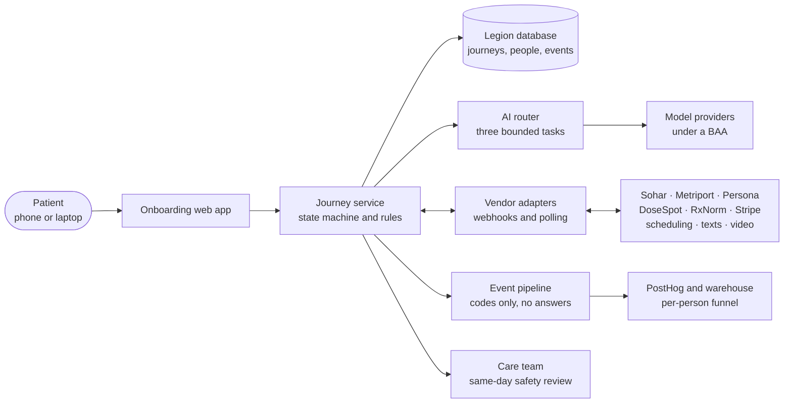
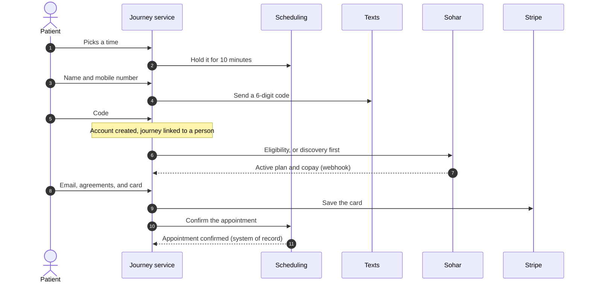
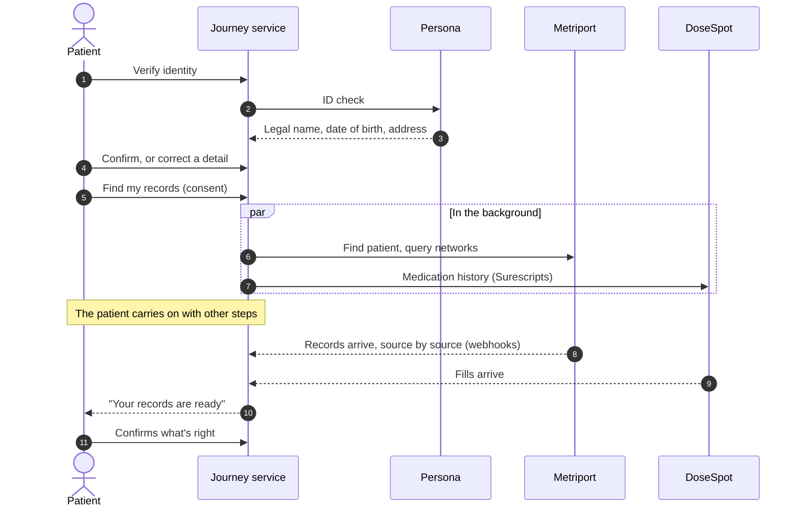
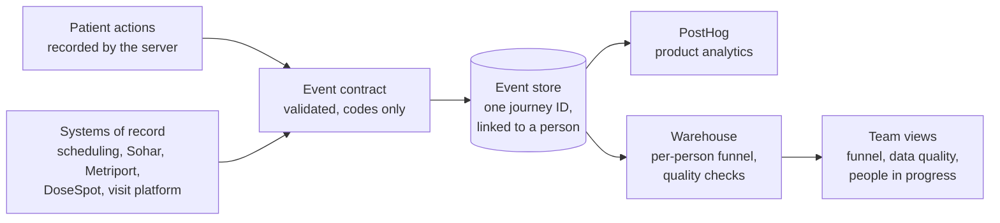
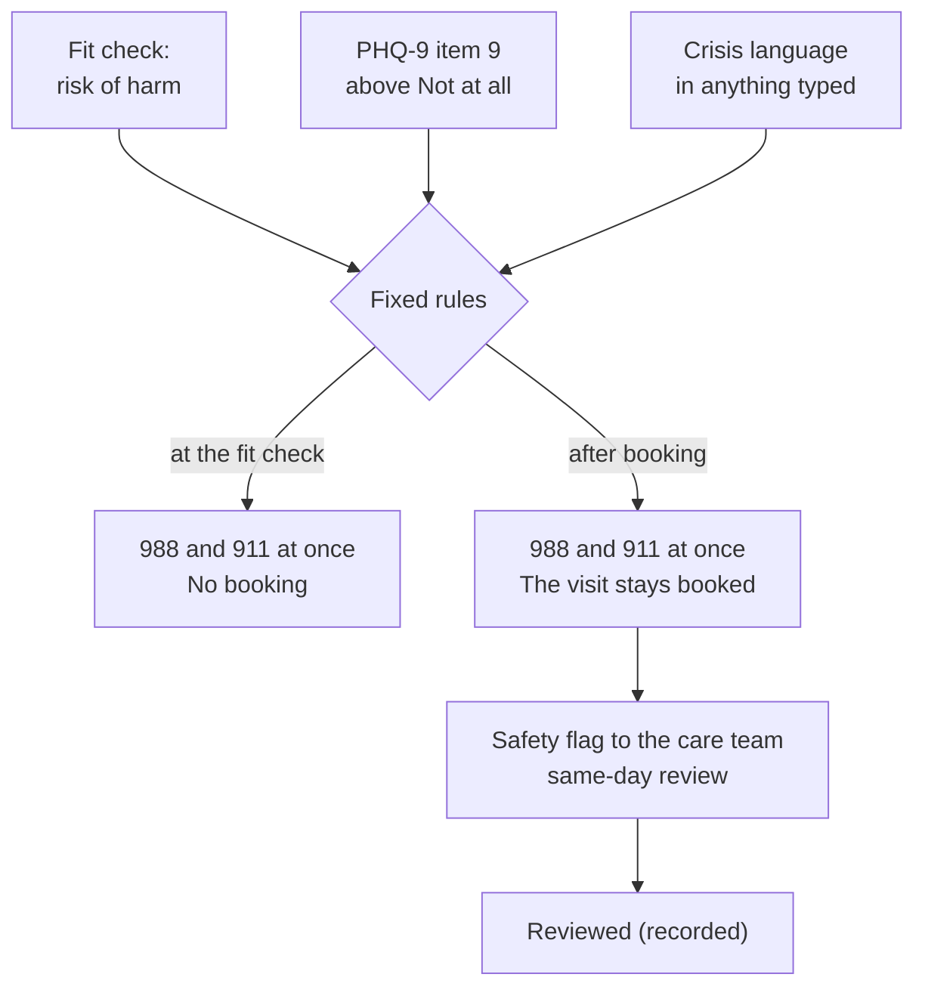
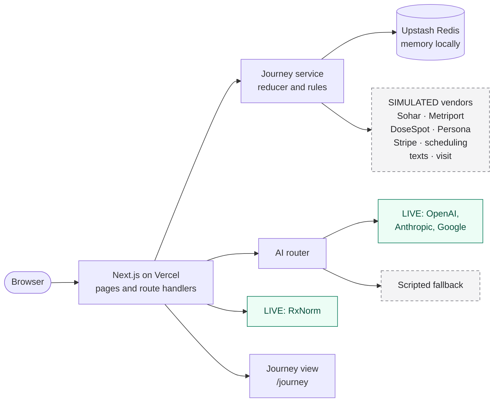
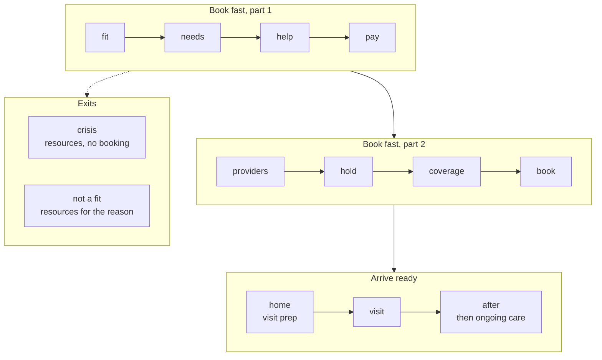
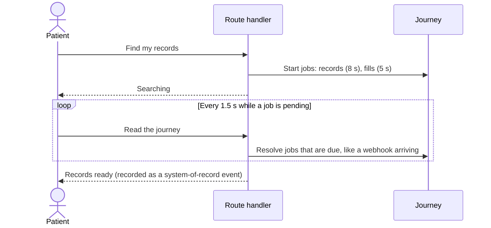

# Architecture: production, the demo, and the path between them

> **At a glance**
> - **Part 1, production:** what Legion would run, with every real service named. **Part 2, the demo:** what is built in this repository and how it stands in for those services. **Part 3:** what changes to go from one to the other, and in what order.
> - **The core is the same in both.** A server-side journey state machine with fixed rules decides every transition. An AI router runs three bounded tasks. Every step records person-level events, with outcomes from systems of record.
> - **What differs is what sits behind the adapters.** In production: Sohar, Metriport, DoseSpot, Persona, Stripe, Legion's scheduling and visit systems, and Legion's database. In the demo: simulations of each, tagged "Simulated" on screen, plus Upstash Redis. Two services are live in the demo: the AI providers and RxNorm.
> - Services in detail: [SERVICES.md](SERVICES.md). The AI and its evaluation plan: [AI.md](AI.md). Implementation detail and acceptance criteria: [TRD.md](TRD.md).

**How to read the diagrams.** Diagrams under Part 1 show production, where every box is a real system. Diagrams under Part 2 show the demo, and every simulated part says "simulated."

| Layer | Production | Demo | Code |
|---|---|---|---|
| Patient app | Next.js web app, mobile first | The same app | `src/app/` |
| Journey logic | Journey service: state machine and rules | The same logic, in route handlers | `src/domain/`, `src/rules/` |
| Healthcare vendors | Sohar, Metriport, DoseSpot (with Surescripts and Bamboo Health), Persona | Simulated, asynchronous, per demo patient | `src/services/sim/` |
| Practice systems | Legion's scheduling, payment (Stripe), texts, video visit | Simulated | `src/services/sim/` |
| Drug vocabulary | RxNorm (or DoseSpot's drug database) | **Live** RxNorm | `src/services/rxnorm.ts` |
| AI | Router over providers under a BAA, with evaluation gates | **Live** router (OpenAI, Anthropic, Google) with a scripted fallback | `src/ai/`, `src/config/ai.config.ts` |
| Storage | Legion's database | Upstash Redis on Vercel; memory locally | `src/store/` |
| Analytics | Server-side events into PostHog and the warehouse | An event log and the `/journey` view; Vercel Web Analytics counts visits to the demo itself | `src/events/`, `src/app/journey/`, `src/app/layout.tsx` |
| Care team | A safety-review queue in Legion's tools | "Mark reviewed" in the journey view | `src/server/viewService.ts` |

---

## Part 1. Production

### 1.1 System context

- **The journey service owns every transition.** Pages send actions; the service checks the stage, applies fixed rules, saves the result, and records events. A page can't skip a step or record an outcome.
- **Vendors answer asynchronously.** Each adapter starts a request, then accepts the vendor's webhook (or polls). The patient keeps moving while it works.
- **Outcomes come from systems of record.** "Appointment confirmed," "records received," and "first visit completed" are recorded when the system that owns them says so, not when a page loads.

### 1.2 Which service serves which step

| Step | Service | What comes back | If it fails or is slow |
|---|---|---|---|
| Fit check | Rules | Eligible, screened out with a reason, or crisis | Not a service call. A crisis answer shows 988 and 911 and stops booking. |
| Providers who fit | Legion's credentialing and scheduling; Sohar network status | Ranked providers, reasons with sources, open times | The nearest times outside the chosen windows, and "text me if an earlier time opens" |
| Preference note | AI router | Up to five preference chips | Scripted chips, or "we couldn't match on that note" |
| Hold a time | Scheduling system; SMS code | A 10-minute hold and a person ID | Another time is offered if the one chosen was just taken |
| Coverage and cost | Sohar: discovery, then eligibility | Plan status and the exact copay | Member-ID entry if discovery finds nothing; "book now, confirm later" after about 15 seconds |
| Book | Stripe; scheduling system | Email for the receipt; card on file; appointment confirmed | A plain error with nothing lost |
| Confirm who you are | Persona | Legal name, date of birth, sex at birth, address, each correctable by the patient | The visit stays booked; a mismatch, or a changed name or birth date, goes to a person |
| Health information | Metriport; DoseSpot (Surescripts fill history) | Visits, conditions, allergies, labs, fills | "Continue with other steps while we search"; an empty result asks what they take |
| Medications mentioned | RxNorm | Ingredient or brand concept | No match shown, nothing blocked |
| Conversation and summary | AI router | Notes and a summary the patient confirms | Scripted notes and a summary built from the confirmed notes |
| Check-in | Rules | GAD-7 and PHQ-9 scores; item 9 flags | Not a service call |
| Pharmacy | DoseSpot | Preferred pharmacy, prefilled from fills | A list nearby |
| Visit | Legion's visit platform | Joined, started, completed | The visit is the system of record for completion |
| After the visit | DoseSpot e-prescribing; scheduling | Prescription sent; follow-up booked | The care team follows up |

### 1.3 Booking: from a held time to a confirmed visit

### 1.4 Getting ready: identity first, then records in the background

### 1.5 AI requests

Every AI request passes a fixed crisis rule first, and on a match no model is called. The router then tries the configured provider and fails over on a timeout, an error, or output that fails the schema, with a scripted answer as the last resort. Nothing the AI produces is saved until the patient confirms it. The flow, the guardrails, and the evaluation plan are in [AI.md](AI.md).

### 1.6 Measurement: from systems of record to the funnel

- **One journey ID from the first page,** linked to a person when the account is created, so events before and after join up. A phone number that's already known reuses the person ID.
- **The headline metric:** first-visit completion among people who pass screening, counted per person, within 14 days of starting. Today's telemetry counts sessions and stops at the payment page.
- **Every event follows a contract:** a name from the catalog, allowed property keys only, codes and timings rather than answers, a source (patient action or system of record), and a version. Invalid events are rejected and counted.
- **Quality checks** look for events out of order, duplicates, linkage gaps, and incomplete chains.
- The full plan is in [TRD.md](TRD.md), section 7.

### 1.7 Safety: rules decide, people review

- No model decides any of this. The crisis check runs before every model call.
- A false alarm costs a resource screen and a human review, never care.
- The review target is 240 minutes (an assumption, TRD section 13).

### 1.8 Data, privacy, and security

- **Protected health information stays in systems built for it.** Legion's database and the vendors, each under a BAA, including the AI providers with zero data retention.
- **Consent before every retrieval.** The patient sees what will be searched and what will be shared before the tap, and the consent is recorded.
- **Every prefilled fact shows its source,** and the patient confirms or unchecks it. Unchecked items stay out of the chart.
- **Analytics never carry answers.** Events hold codes and timings only, and a test fails if one carries free text.
- **No phone-linked prefill.** The phone number creates the account and resumes the journey; it never pulls in identity data.
- **Sessions** use a signed first-party cookie. Resuming on another device needs a texted code, and repeated wrong codes lock that number for ten minutes.

### 1.9 Reliability

- **Asynchronous by design.** Vendor work runs in the background with webhooks, falling back to polling, and every handler is idempotent so a repeated webhook changes nothing.
- **Timeouts become choices, not errors.** A slow insurer leads to "book now, confirm later"; a slow records search leads to "continue with other steps"; a failed AI call leads to the scripted answer.
- **Holds expire** after 10 minutes unless renewed, so an abandoned hold frees the time.

---

## Part 2. The demo, as built

### 2.1 Runtime

Green boxes are live services; grey dashed boxes are simulated or scripted.

- **One Next.js app** holds the pages and the route handlers. Every action goes to `POST /api/journey/action`, which runs the reducer and saves the journey and its events.
- **The reducer is pure.** `applyAction(journey, action, context)` returns the next journey and the events to record, and refuses an action at the wrong stage. That is what makes the journeys testable end to end without a browser.
- **Simulated vendors answer per demo patient.** Maya's plan is active, Jordan's records search finds nothing, Sam's plan is inactive, and a journey without a demo patient gets generic results.

### 2.2 The journey's stages

- **Book fast** is `fit` to `book`: eight stages, first about the patient and then choosing and committing. Self-pay patients skip `coverage`. **Arrive ready** is `home`, `visit`, and `after`. The two exits leave from the fit check.
- `home` holds the visit prep: four areas (who you are, your health information, what you need help with, the pharmacy), defined in `src/rules/prep.ts`. After the first visit, the same `/home` route becomes the ongoing-care dashboard.
- Before booking, "Back" steps back one stage. After booking, earlier stages can't be changed.

### 2.3 How a simulated vendor answers

- Jobs resolve when the journey is next read after their ready time, so the demo needs no background workers.
- `DEMO_FAST=1` divides every wait by 20 for the automated tests.

### 2.4 Code map

| Folder | What's there |
|---|---|
| `src/app/` | The screens (Book fast under `start/`, visit prep under `home/`, `visit/`, `after/`, the journey view) and the route handlers under `api/` |
| `src/domain/` | Types, the validated actions, the reducer, stages, and the browser-safe view of a journey |
| `src/rules/` | Eligibility, crisis language, questionnaires, controlled substances, matching and reasons, cost, readiness, visit-prep areas, time zones |
| `src/ai/`, `src/config/ai.config.ts` | The router, the three tasks with their scripted fallbacks, the summary filter, and the one file that sets providers and models |
| `src/services/` | Simulated vendors (`sim/`) and the live RxNorm client |
| `src/server/` | Services behind the routes, and sessions |
| `src/store/` | The store contract and its two implementations: Upstash Redis and memory |
| `src/events/` | The event catalog, validation, metrics, quality checks, the invented cohort |
| `src/data/` | Invented providers, demo patients, pharmacies, plans, questionnaires |
| `tests/` | Unit, integration, end-to-end, live, and evaluation suites |

### 2.5 Storage, sessions, and demo protections

- **Storage.** A journey and its events live for seven days in Upstash Redis on Vercel, or in memory locally and in tests. Both stores pass the same contract tests.
- **Sessions.** A signed cookie holds the journey ID. Resuming on another device uses the mobile number and a code shown on screen.
- **Protections for a public demo.** Each demo journey gets its own fictional 555-01xx number; five wrong codes lock resuming for ten minutes; live AI calls are capped per journey and per day; the demo banner asks visitors not to enter real health information.

### 2.6 What a reviewer can do

- **Demo controls** (top right) start as one of three demo patients, fill the current step, switch on the edge cases (a slow insurer, a time taken a moment before), mark a safety flag reviewed, and open the journey view.
- **The journey view** (`/journey`) shows this journey's events in order, the per-person funnel for live demo journeys next to an invented 400-person cohort, today's funnel against the rebuild, data quality, and people in progress.

### 2.7 Limits of the demo

- Vendor answers are invented to match each service's documented behavior, not taken from real calls.
- Texts aren't sent; the code shows on screen. No card is charged. The video visit is a stand-in.
- Visit outcomes, including the prescriptions, are written ahead of time for each demo patient.
- The matching logic, hold length, readiness requirements, and safety review time are stated assumptions (TRD section 13).

---

## Part 3. From demo to production

| Part | What carries over as is | What changes |
|---|---|---|
| Journey logic and rules | The reducer, stages, rules, and their tests | Runs inside Legion's backend, against Legion's database |
| Vendor adapters | The interface each simulation implements | Real clients for Sohar, Metriport, Persona, DoseSpot, Stripe, scheduling, texts, and video, with signed webhooks, idempotency, and retries |
| AI | The router, tasks, schemas, filter, and fallbacks | BAAs and zero data retention, versioned prompts, and the evaluation gates in [AI.md](AI.md) |
| Events | The catalog, contract, metrics, and quality checks | Delivered to PostHog and the warehouse; outcomes from real systems of record |
| Storage and sessions | The store contract | Legion's database; accounts tied to Legion's existing patient records |
| Care team | The flag, its review, and the target time | A real review queue with alerts |

**A sensible order.** Each step stands on its own and can be measured against today's baseline.

1. **Measurement first.** Server-side, person-level events through the first visit, so every later change has a before and after.
2. **Trust at matching.** Reasons with sources, time windows, and the preference note.
3. **The light account and resume by phone,** where one in five held slots is lost today.
4. **Coverage and cost before the card,** with Sohar, which Legion already uses.
5. **Visit prep that retrieves before it asks:** Persona, then Metriport and DoseSpot, with consent.
6. **The guided conversation,** after the AI evaluation gates pass.
